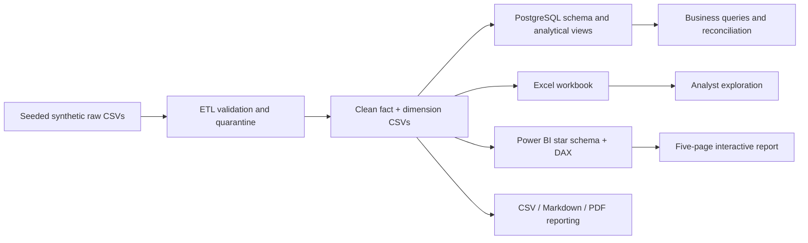

# Pricing Optimization Dashboard — Product Revenue, Discount Effectiveness & Profitability Intelligence

A reproducible end-to-end analytics portfolio project for Data Analyst, BI Analyst, Pricing Analyst, Revenue Analyst and Category Analyst roles. It connects synthetic transaction data, ETL/data-quality controls, PostgreSQL analytics, an Excel workbook, Power BI implementation artifacts, automated reporting, and tests.

> **Data disclosure:** all transaction, product, region, price, cost, and performance data are synthetic, generated with seed `20261028`. Findings are illustrative and are not actual company results or experimentally validated improvements.

## Business problem

Pricing and category teams need a consistent way to investigate revenue, gross profit, margin, discount depth, and price/cost exceptions. This project demonstrates how to identify products worth reviewing, compare discount bands descriptively, and test explicit what-if assumptions without presenting observational patterns as causal effects.

## Quick start (Windows PowerShell)

```powershell
cd pricing-optimization-dashboard
py -m venv .venv
.\.venv\Scripts\Activate.ps1
python -m pip install -r requirements.txt
python python/generate_dataset.py
python python/validate_data.py
python python/build_workbook.py
python python/generate_reports.py
python -m pytest -q
```

On macOS/Linux replace activation with `source .venv/bin/activate`. Python 3.10+ is recommended. Generated outputs are reproducible; dataset generation uses a fixed seed.

## Architecture



## Dataset

- 20,000 clean sales-line records spanning 2024-01-01 to 2025-12-31.
- 120 products, 10 categories, 5 regions, 4 channels, 4 customer segments.
- One row per order/product line; this generated dataset uses one line per order, so distinct order count equals row count. Real data commonly has multiple lines per order.
- Six intentionally imperfect raw rows are quarantined with explicit reasons; no rejected row is silently discarded.
- Source files: `data/raw/`; cleaned facts/dimensions and quality reports: `data/processed/`.

## Metric definitions

- Gross revenue before discount = quantity × unit list price.
- Discount amount = quantity × (unit list price − unit selling price).
- Net sales revenue = quantity × unit selling price.
- Cost of goods sold (COGS) = quantity × unit cost.
- Gross profit = net sales revenue − COGS.
- Gross margin % = gross profit ÷ net sales revenue.
- Weighted average discount % = total discount amount ÷ gross revenue before discount.
- Average selling price = net sales revenue ÷ units sold.
- Revenue per order = net sales revenue ÷ distinct orders.

Ratios are calculated as ratios of sums, with safe division. Gross profit is not net profit: returns, taxes, shipping, payment fees, marketing, and operating expenses are excluded.

## SQL analytics

`database/01_create_schema.sql` creates constrained PostgreSQL tables and indexes. `02_load_data.sql` shows `psql \copy` imports. `03_data_quality_checks.sql` validates integrity and financial reconciliations. `04_analytical_views.sql` creates enriched, product-level and monthly views. `05_business_analysis.sql` contains 20 business questions using CTEs, CASE, date operations, window functions, rankings, rolling sums, growth comparisons, discount bands and outlier flags. SQL has been authored for PostgreSQL but not executed here because a PostgreSQL server/client is unavailable in this environment.

For Python loading, set `DATABASE_URL` locally (see `config/config.example.env`) after creating the schema, then run `python python/load_database.py`. Do not commit credentials.

## Excel workbook

Open `excel/pricing_analysis_workbook.xlsx` in Excel. Worksheets: Executive Summary, Raw Data, Cleaned Data, Product Master, Pricing Analysis, Discount Analysis, Category Profitability, Monthly Trends, Data Quality, Methodology. The workbook includes structured tables, calculated summary tables, KPI summary, a category chart, filters, conditional formatting and metric notes. Native PivotTables/slicers are not generated by this automated build; add them in Excel from the structured tables if desired. Refresh the workbook by rerunning `python python/build_workbook.py` after refreshing the processed CSVs.

## Power BI

The environment does not support Power BI Desktop authoring, so **no PBIX is claimed or included**. The deliverables are:
- `powerbi/data_model.md`: star schema and ER diagram.
- `powerbi/dax_measures.md`: core measures, time intelligence, flags and scenario measures.
- `powerbi/dashboard_build_guide.md`: complete five-page implementation steps.
- `powerbi/theme.json`: report theme.

The five specified pages are Executive Pricing Overview, Product & Category Profitability, Discount Effectiveness, Pricing Opportunity & Exceptions, and What-if Pricing Simulator. Import the processed CSVs into Power BI Desktop, apply the model and measures, then save the PBIX yourself. Validate metrics against `reports/*.csv` before sharing screenshots.

## Automated reporting

Run `python python/generate_reports.py`. It produces:
- `reports/executive_summary.md`
- `reports/pricing_recommendations.md`
- `reports/category_performance.csv`
- `reports/monthly_performance.csv`
- `reports/discount_band_performance.csv`
- `reports/pricing_exceptions.csv`
- `reports/sample_report.pdf`

Report generation timestamp is included in the Markdown/PDF. This is a local batch workflow; Power BI Service refresh, gateways, scheduled delivery and email subscriptions are not configured.

## Sample findings from the generated dataset

See `reports/executive_summary.md` and `reports/category_performance.csv` for the actual values calculated from this generated run. Current run: net sales revenue **4,716,195.44**, gross profit **1,438,514.27**, gross margin **30.50%**, and **26** products flagged by screening rules. These values are synthetic and should be described as calculated portfolio-project results, not real business impact. Category rankings and discount-band results are in the output CSVs.

## Data-quality strategy and tests

Run `python python/validate_data.py` for schema, uniqueness, range, foreign-key and reconciliation checks. Results are written to `data/processed/validation_report.json`. Run `python -m pytest -q` for the automated suite covering schema, ranges, quarantine, financial math, scenario arithmetic, report output existence and report/fact reconciliation. Database and Power BI integrations are not tested in this environment.

## Portfolio case study

**Business question:** How can a retailer consistently monitor product profitability and investigate discount-related risks? **Approach:** create a reproducible synthetic dataset; quarantine invalid source records; derive financial metrics from common definitions; use SQL for product/category/month/channel analysis; use Excel for analyst exploration; define a Power BI star schema, DAX and report pages; generate executive and exception reports; reconcile calculations with automated tests. **Output:** a traceable analytical workflow with review flags and what-if scenarios. **Limitation:** the data are synthetic and observational; recommendations are hypotheses to validate, not causal conclusions.

## Resume-ready description

Built a reproducible pricing and profitability analytics solution using Python, SQL, Excel and Power BI source artifacts to analyze 20,000 synthetic transaction lines, reconcile revenue/cost/margin metrics, flag pricing exceptions, and generate executive reports. (Only claim Power BI report implementation as complete after building and validating the PBIX in Desktop.)

## Known limitations / future improvements

- Execute schema, COPY and analytical SQL against a local PostgreSQL instance and add automated SQL-vs-Python reconciliation.
- Complete and validate the Power BI PBIX; add native PivotTables/slicers in Excel if needed.
- Add realistic multi-line orders, returns, inventory, competitor benchmark provenance, and historical cost/price changes.
- Use randomized price tests or causal inference to estimate elasticity; do not treat the scenario assumption as an estimate.
- Add CI, logging/monitoring, and scheduled report generation in a user-controlled environment.

## Repository map

See `docs/` for business requirements, data dictionary, methodology, architecture, and limitations. See `tests/` for the runnable test suite. All sample screenshots should be added only after rendering the actual report/workbook.
