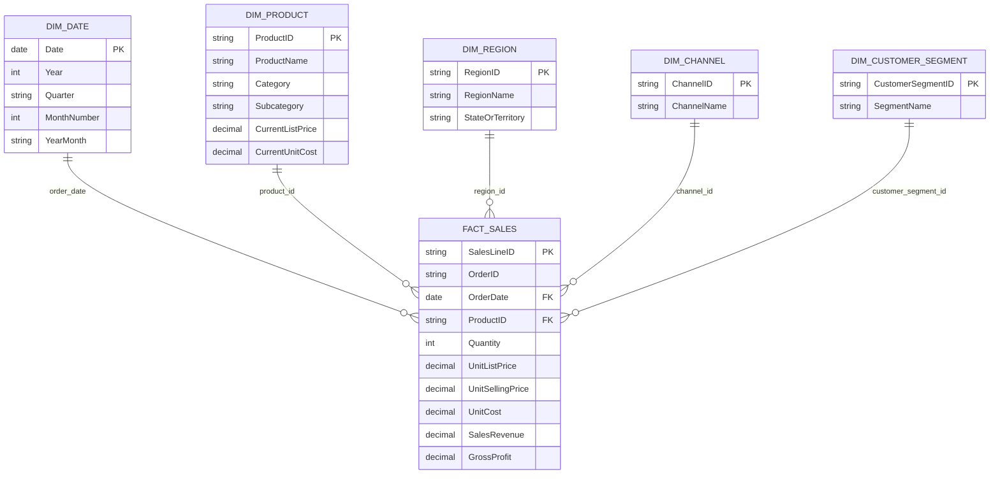

# Power BI Data Model

Use single-direction dimension-to-fact relationships, 1:* cardinality, no bidirectional filters by default. `DimProduct[CurrentListPrice]` and `[CurrentUnitCost]` are current master attributes; they are not historical transaction prices. Historical realized price and cost are in FactSales. `DimDate[Date]` must be marked as the date table. The synthetic source has one sales line per OrderID; real data generally needs multiple lines per order and distinct order counts must remain distinct-count measures.
